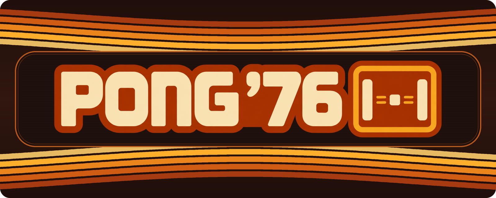

# Pong '76

<p align="center">
  
</p>

Pong '76 is an experimental Copilot AI-developed game inspired by the
late-1970s Grandstand *Squash* consoles. It includes a Rust desktop game and
a port for the ZX Spectrum 48K.

## Desktop game

The setup screen offers one or two players, paddle size, ball angle and speed,
colour, scanlines, keyboard or joystick controls, and autoserve. Paddle movement
and off-centre hits add slice and spin. First to 11 points with a two-point
lead wins.

- Player 1: W/S; player 2: up/down arrows.
- Space serves; Escape returns to setup; Enter starts a new match after a win.
- Joysticks use the left stick or D-pad to move and the South button (A/X) to
  serve or replay. The Pause/Resume button pauses play.

If audio output is unavailable, the game remains playable and reports the
error in the UI and terminal.

Install Rust and Cargo, then run:

```bash
cargo run
cargo test
```

If a network drive causes incremental compilation cache errors, use
`CARGO_TARGET_DIR="$HOME/.cache/pong76-target" cargo run` (or `cargo test`).
Linux packaging scripts expect the default `target` directory.

## ZX Spectrum 48K version

Load the [Spectrum TAP](ports/zx-spectrum/pong76.tap) with `LOAD ""`. Its BASIC
loader displays a loading screen, loads the Z80 game at address 30000 and
starts it automatically. The menu plays an original beeper tune; wall and
paddle hits have different pitches. First to 11 with a two-point lead wins.

- Player 1: A/Z; player 2: O/L. Space starts, serves and returns to the menu.
- Menu: 1/2 players, 3/4 small/large paddles, 5/6 slow/fast, 7/8 white/green.
  Defaults are one player, small paddles, slow speed and white.
- 1/2 can also select player mode while waiting to serve.

To rebuild the TAP, install Pasmo and run:

```bash
python3 ports/zx-spectrum/build.py
```

The checked-in [menu screen](ports/zx-spectrum/menu.scr) is assembled into the
game, and the [loading screen](ports/zx-spectrum/loading.scr) is included in
the tape. To regenerate both screens and their
[menu](ports/zx-spectrum/menu-preview.png) and
[loading](ports/zx-spectrum/loading-preview.png) previews, install Pillow and
run `python3 ports/zx-spectrum/make_menu.py`.
For the Spectrum regression tests, install Pasmo and libz80ex, then run
`python3 -m unittest discover -s ports/zx-spectrum -p 'test_*.py'`.

## Packages

### Linux AppImage

The x86_64 AppImage is available at
[dist/Pong-76-x86_64.AppImage](./dist/Pong-76-x86_64.AppImage). To rebuild it,
install `appimagetool` and run:

```bash
APPIMAGETOOL=/path/to/appimagetool packaging/linux/build-appimage.sh
```

### Linux Snap

The amd64 Snap package is available at
[dist/pong-76_0.1.0_amd64.snap](./dist/pong-76_0.1.0_amd64.snap). To rebuild
it, run:

```bash
packaging/snap/build-snap.sh
```

Install the local package with:

```bash
sudo snap install --dangerous dist/pong-76_0.1.0_amd64.snap
```

### Linux Flatpak

The x86_64 Flatpak bundle is available at
[dist/Pong-76.flatpak](./dist/Pong-76.flatpak). To rebuild it, install Cargo,
the Flatpak CLI, and the Freedesktop Platform 26.08 runtime, then run:

```bash
packaging/flatpak/build-flatpak.sh
```

Install the local bundle with:

```bash
flatpak install --user dist/Pong-76.flatpak
```

### Windows

The x86_64 [WiX installer](./dist/Pong-76-Setup.msi) includes a feature
selection screen where the optional desktop shortcut can be enabled. It
installs a Start Menu shortcut and can be removed through Windows settings.
The [portable ZIP](./dist/Pong-76-Portable.zip) can be extracted and run
without installation.

To rebuild on Linux, install Rust, the `x86_64-pc-windows-gnu` Rust target,
MinGW-w64, `zip`, and WiX 6 with `WixToolset.UI.wixext`:

```bash
rustup target add x86_64-pc-windows-gnu
wix extension add -g WixToolset.UI.wixext/6.0.2
packaging/windows/build-windows.sh
```

For WiX under Wine, set `WIX_WINE_DOTNET`, `WIX_WINE_DLL` and
`WIX_UI_EXTENSION` to the corresponding Windows files before running the script.

## Credits

Created by Neil Feltham with Copilot to explore AI-assisted game development.
The Righteous font by Astigmatic is distributed under the
[SIL Open Font License](assets/Righteous-OFL.txt).
